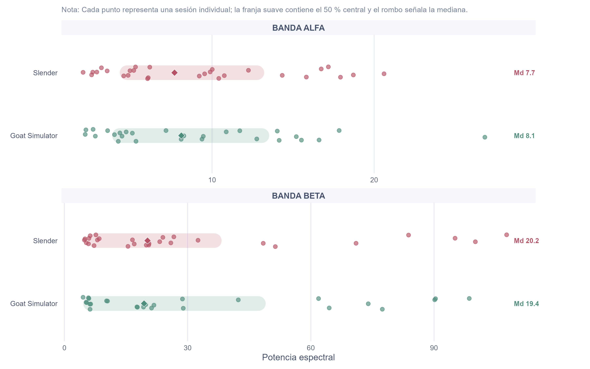
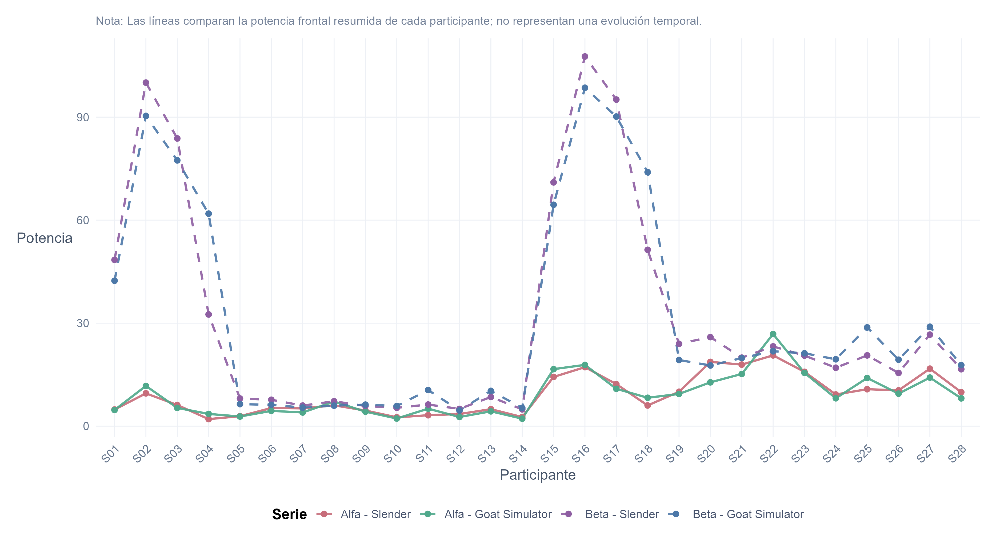
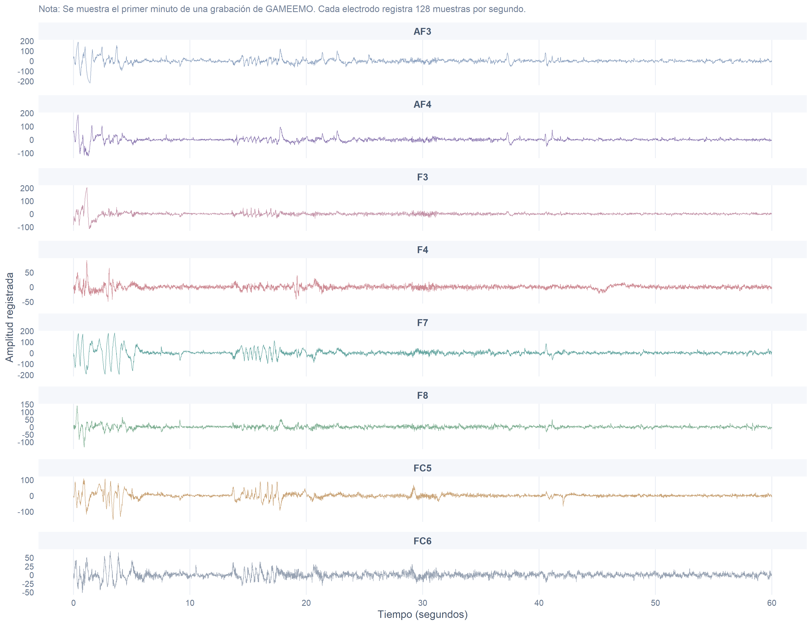
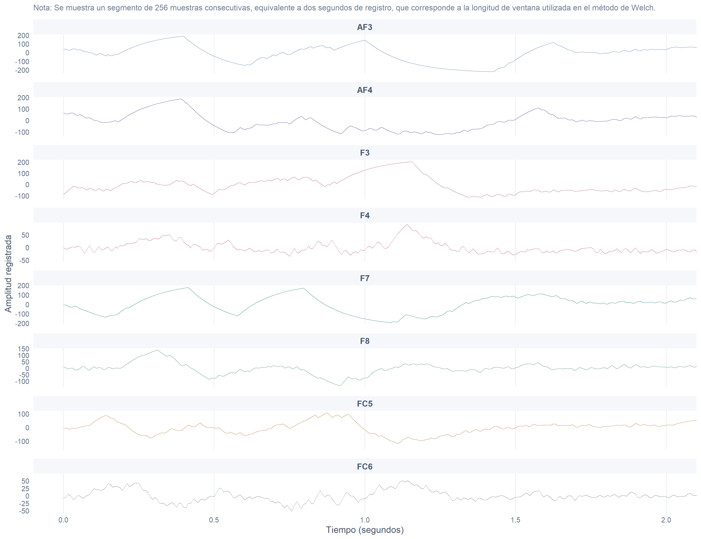
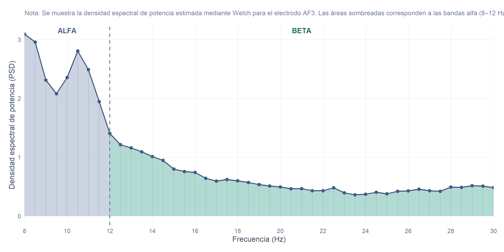

---
lang: es
format:
  pdf:
    fontsize: 12pt
    geometry:
      - margin=2.5cm
    number-sections: false
    include-in-header:
      text: |
        \usepackage{float}
execute:
  echo: false
  warning: false
  message: false
---

```{=latex}
\begingroup
\setlength{\parindent}{0pt}
\setlength{\parskip}{0pt}

\textbf{Universidad de Costa Rica}\par
Escuela de Matemática\par
CA-0204 --- Herramientas de Ciencia de Datos I\par
II ciclo, 2026\par

\vspace{0.25cm}

{\large\textbf{El cerebro vs las emociones}}\par
Análisis de respuestas emocionales y actividad EEG en GAMEEMO\par

\vspace{0.25cm}

Dylan Madrigal Jiménez\par

\vspace{0.25cm}

25 de noviembre de 2026\par

\href{https://github.com/dylanmega2016-design/Individual_MadrigalJimenezDylan_HerramientasDatosI_2026}{Repositorio del proyecto en GitHub}\par

\vspace{0.35cm}
\hrule
\endgroup
```

## Introducción 

Los videojuegos ofrecen experiencias que pueden generar distintas respuestas emocionales, desde miedo e incomodidad hasta tranquilidad y diversión. Sin embargo, las emociones no necesariamente se reflejan de manera directa en un único indicador de actividad cerebral. Mediante el electroencefalograma (EEG) es posible estudiar las oscilaciones eléctricas registradas en el cuero cabelludo, cuyas bandas alfa y beta se han relacionado con procesos atencionales, cognitivos y sensoriomotores (Engel & Fries, 2010; Klimesch, 2012).

Esta investigación utiliza GAMEEMO, un conjunto de datos desarrollado por Alakus et al. (2020a), que contiene registros EEG y evaluaciones emocionales de 28 participantes durante cuatro videojuegos. La relevancia del análisis radica en examinar si experiencias emocionalmente contrastantes presentan diferencias en sus potencias espectrales alfa y beta, con especial atención a Slender: The Arrival y Goat Simulator, mediante la comparación con las respuestas del cuestionario Self-Assessment Manikin (SAM).

## Objetivo 

Comparar los resultados entre las respuestas emocionales registradas mediante los cuestionarios SAM y las potencias espectrales alfa y beta obtenidas de las señales EEG durante cuatro videojuegos, con énfasis en las diferencias entre *Slender: The Arrival* y *Goat Simulator*.

## Metodología

Se realizó un análisis exploratorio y descriptivo utilizando GAMEEMO (Alakus et al., 2020b), que contiene registros EEG de 28 participantes durante cuatro videojuegos: Train Sim World (G1), Unravel (G2), Slender: The Arrival (G3) y Goat Simulator (G4). Cada participante jugó aproximadamente cinco minutos y evaluó su experiencia mediante el cuestionario SAM, que registra la valencia (agrado o desagrado) y la activación emocional.

El procesamiento se realizó en R mediante los paquetes tidyverse, readxl y gsignal. Se organizaron las respuestas SAM y se importaron los 112 archivos CSV preprocesados de EEG, correspondientes a 14 electrodos registrados a una frecuencia de 128 Hz. Se revisó la presencia de valores faltantes y se eliminaron las columnas vacías.

Los anexos A, B y C ilustran las señales EEG y su transformación al dominio de la frecuencia. Debido a que las señales EEG contienen componentes de distintas frecuencias, se utilizó el método de Welch (1967) para estimar su densidad espectral de potencia. Este procedimiento divide la señal en segmentos, aplica la transformada de Fourier y promedia los espectros obtenidos, reduciendo la variabilidad de la estimación (Zhang et al., 2023, pp. 9, 31).

Mediante la función pwelch() del paquete gsignal se emplearon segmentos de 256 muestras, equivalentes a dos segundos de medición, con una ventana Hamming para reducir las distorsiones asociadas con cortes bruscos. Se estableció un solapamiento del 50 % (128 muestras compartidas entre segmentos) y una transformada rápida de Fourier de 256 puntos.

Posteriormente, se calcularon las potencias de las bandas alfa (8–12 Hz) y beta (12–30 Hz), seleccionadas por su relevancia en procesos atencionales, cognitivos y sensoriomotores (Engel & Fries, 2010; Klimesch, 2012). Mediante la regla del trapecio se aproximó el área bajo la curva de densidad espectral, obteniendo una potencia por banda y electrodo.

Se seleccionaron ocho electrodos frontales y frontocentrales (AF3, AF4, F3, F4, F7, F8, FC5 y FC6), debido al interés de estas posiciones en investigaciones sobre procesamiento emocional y motivación (Smith et al., 2017). Para cada participante y videojuego se calculó la mediana de las potencias de los ocho electrodos, reduciendo la influencia de valores extremos. Posteriormente, se obtuvieron las medianas grupales por videojuego.

Finalmente, se realizó una comparación pareada entre Slender y Goat Simulator, calculando las diferencias individuales de valencia, activación y potencia espectral (G4 − G3). Se obtuvieron las medianas de estas diferencias y el porcentaje de participantes con diferencias absolutas de potencia inferiores a una unidad, como criterio exclusivamente descriptivo.

\newpage

## Resultados 

### Resultados del análisis SAM

Las respuestas del cuestionario SAM muestran diferencias en las experiencias emocionales reportadas durante los cuatro videojuegos. Como se observa en la @tbl-resumen-sam, Train Sim World y Slender presentaron las menores medianas de valencia (3 puntos), mientras que Unravel y Goat Simulator alcanzaron las mayores (7 puntos). En cuanto a la activación emocional, Train Sim World presentó la menor mediana (3), seguido de Unravel (4), Goat Simulator (6) y Slender (6,5).

El contraste entre Slender y Goat Simulator resulta particularmente interesante, pues ambos videojuegos presentaron medianas de activación cercanas, pero puntuaciones de valencia claramente diferenciadas. Esto permite comparar dos experiencias con niveles grupales de activación similares, aunque con distinto grado de agrado declarado.

```{r}
#| label: tbl-resumen-sam
#| tbl-cap: "Medianas de valencia y activación emocional por videojuego."
#| tbl-pos: "H"
#| echo: false
#| message: false
#| warning: false
#| cache: false

library(tidyverse)
library(tinytable)

# Color del encabezado
azul <- "#34435E"

# Importación y selección de los resultados SAM
tabla.sam <- read_csv(
  "../res/comparacion_juegos.csv",
  show_col_types = FALSE
) |>
  dplyr::select(
    nombre_videojuego,
    mediana_valencia,
    mediana_activacion,
    participantes
  ) |>
  rename(
    Videojuego = nombre_videojuego,
    Valencia = mediana_valencia,
    Activación = mediana_activacion,
    Participantes = participantes
  ) |>
  mutate(
    Activación = format(
      Activación,
      trim = TRUE,
      decimal.mark = ","
    )
  )

# Generación de la tabla
tabla.sam |>
  tt(
    notes = "Fuente: elaboración propia con datos de GAMEEMO (Alakus et al., 2020b).",
    escape = TRUE,
    theme = "striped"
  ) |>
  style_tt(
    i = 0,
    bold = TRUE,
    color = "white",
    background = azul
  ) |>
  style_tt(j = 1, bold = TRUE) |>
  style_tt(j = 2:4, align = "r")
```

Al comparar las respuestas individuales, 27 de los 28 participantes reportaron una mayor valencia en Goat Simulator y uno presentó la misma puntuación en ambos videojuegos. La mediana de las diferencias fue de 4 puntos. Respecto a la activación emocional, 15 participantes reportaron una mayor activación en Slender, 10 en Goat Simulator y 3 presentaron puntuaciones iguales, con una mediana de las diferencias de −1 punto (G4 − G3).

\newpage

### Resultados de las señales EEG

En los cuatro videojuegos, las medianas grupales de potencia alfa oscilaron entre 7,56 y 8,87, mientras que las correspondientes a la banda beta se situaron entre 17,9 y 20,2.

Como se observa en la Figura 1, Slender y Goat Simulator presentaron distribuciones de potencia EEG frontal con una considerable superposición. La mediana de potencia alfa fue ligeramente superior en Goat Simulator (8,11 frente a 7,68), mientras que la mediana de potencia beta fue mayor en Slender (20,2 frente a 19,4).

Cada punto de la Figura 1 representa la potencia espectral resumida de un participante, mientras que la franja coloreada contiene el 50 % central de los datos y el rombo señala la mediana grupal. La superposición de las distribuciones y la dispersión de las observaciones evidencian que las potencias espectrales no presentan una separación visual tan marcada como las puntuaciones de valencia del cuestionario SAM, sino que muestran una cercanía grupal semejante a la observada en la activación emocional.

{#fig-eeg fig-pos="H" width="85%"}

### Comparación individual de las potencias EEG

Como se observa en la Figura 2, las potencias espectrales presentan variaciones importantes entre participantes. En particular, se identifican participantes con valores elevados de potencia beta en ambos videojuegos, mientras que otros presentan valores considerablemente menores. Este comportamiento sugiere que parte de la variabilidad observada se relaciona con diferencias individuales que se manifiestan durante ambas experiencias.

{#fig-eeg-individual fig-pos="H" width="80%"}

El 46,4 % de los participantes presentó diferencias absolutas de potencia inferiores a una unidad en la banda alfa, frente al 25 % en la banda beta. Las medianas de las diferencias individuales (Goat Simulator menos Slender) fueron de −0,409 y −0,292, respectivamente.

Aunque las medianas de las diferencias espectrales fueron cercanas a cero, esto no implica que todos los participantes presentaran potencias similares. Las líneas del gráfico facilitan la comparación individual y no representan una evolución temporal.

### Interpretación final y limitaciones

Los resultados sugieren que el comportamiento grupal de las potencias alfa y beta frontales presenta una mayor similitud con el patrón observado en la activación emocional que con el de la valencia. Aunque Slender y Goat Simulator generaron experiencias distintas en términos de agrado, ambos presentaron medianas cercanas en activación y potencia espectral.

Considerando que la banda alfa se relaciona con la selección e inhibición de información (Klimesch, 2012) y la banda beta con procesos cognitivos y sensoriomotores (Engel & Fries, 2010), una posible explicación es que ambos videojuegos involucren demandas semejantes de atención, procesamiento de información y toma de decisiones, independientemente del agrado experimentado.

No obstante, la investigación se limita a 28 participantes, ocho electrodos y dos bandas espectrales. Su carácter descriptivo no permite confirmar una asociación estadística con la activación emocional, establecer causalidad ni demostrar que los procesos cognitivos sean equivalentes entre ambos videojuegos.

\newpage

```{=latex}
\begin{center}
\textbf{Referencias}
\end{center}

\begingroup
\setlength{\leftskip}{1.27cm}
\setlength{\parindent}{-1.27cm}
\setlength{\parskip}{0pt}
\linespread{2}\selectfont

Alakus, T. B., Gonen, M., \& Turkoglu, I. (2020a).
Database for an emotion recognition system based on EEG signals
and various computer games -- GAMEEMO.
\textit{Biomedical Signal Processing and Control, 60}, Article 101951.
\url{https://doi.org/10.1016/j.bspc.2020.101951}

Alakus, T. B., Gonen, M., \& Turkoglu, I. (2020b).
\textit{Database for emotion recognition system based on EEG signals
and various computer games -- GAMEEMO} (Version 3) [Data set].
Mendeley Data.
\url{https://doi.org/10.17632/b3pn4kwpmn.3}

Engel, A. K., \& Fries, P. (2010).
Beta-band oscillations---signalling the status quo?
\textit{Current Opinion in Neurobiology, 20}(2), 156--165.
\url{https://doi.org/10.1016/j.conb.2010.02.015}

Klimesch, W. (2012).
Alpha-band oscillations, attention, and controlled access
to stored information.
\textit{Trends in Cognitive Sciences, 16}(12), 606--617.
\url{https://doi.org/10.1016/j.tics.2012.10.007}

Smith, E. E., Reznik, S. J., Stewart, J. L., \& Allen, J. J. B. (2017).
Assessing and conceptualizing frontal EEG asymmetry:
An updated primer on recording, processing, analyzing,
and interpreting frontal alpha asymmetry.
\textit{International Journal of Psychophysiology, 111}, 98--114.
\url{https://doi.org/10.1016/j.ijpsycho.2016.11.005}

Welch, P. D. (1967).
The use of fast Fourier transform for the estimation of power spectra:
A method based on time averaging over short, modified periodograms.
\textit{IEEE Transactions on Audio and Electroacoustics, 15}(2), 70--73.
\url{https://doi.org/10.1109/TAU.1967.1161901}

\textit{Acceso alternativo al texto completo:}
\href{https://blog.ioces.com/matt/posts/colouring-noise/welch-1967.pdf}{Consultar artículo original en PDF.}

Zhang, H., Zhou, Q.-Q., Chen, H., Hu, X.-Q., Li, W.-G., Bai, Y.,
Han, J.-X., Wang, Y., Liang, Z.-H., Chen, D., Cong, F.-Y.,
Yan, J.-Q., \& Li, X.-L. (2023).
The applied principles of EEG analysis methods in neuroscience
and clinical neurology.
\textit{Military Medical Research, 10}(1), Article 67.
\url{https://doi.org/10.1186/s40779-023-00502-7}

\par
\endgroup
```

\newpage

## Anexos

## Anexo A. Material complementario del procesamiento EEG

Las siguientes figuras se incluyen exclusivamente como material ilustrativo del procedimiento metodológico descrito en el informe. Su propósito es visualizar la estructura de las señales EEG, la segmentación temporal y la estimación de la densidad espectral de potencia mediante el método de Welch.

La Figura 3 muestra el comportamiento de las señales EEG preprocesadas durante el primer minuto de una sesión de juego, antes de aplicar el análisis espectral.

{#fig-anexo-a fig-pos="H" width="100%"}

\newpage

### Anexo B. Segmento de dos segundos de las señales EEG

La Figura 4 muestra un segmento de 256 muestras consecutivas, equivalente a dos segundos de medición a una frecuencia de muestreo de 128 Hz. Esta duración corresponde a la longitud de los segmentos utilizados en el método de Welch.

{#fig-anexo-b fig-pos="H" width="100%"}

\newpage

### Anexo C. Estimación de la densidad espectral de potencia

La Figura 5 muestra la densidad espectral de potencia del electrodo AF3, estimada mediante el método de Welch. Las regiones correspondientes a las bandas alfa (8–12 Hz) y beta (12–30 Hz) permiten visualizar los intervalos sobre los cuales se aplicó la regla del trapecio para obtener las respectivas potencias espectrales.

{#fig-anexo-c fig-pos="H" width="100%"}

\newpage

### Anexo D. Uso de inteligencia artificial

Durante el desarrollo de este proyecto se utilizó ChatGPT, herramienta de inteligencia artificial desarrollada por OpenAI, como recurso de apoyo para la revisión y corrección del código en R, la elaboración y el diseño de visualizaciones estadísticas y la revisión de la redacción del informe.

El uso de esta herramienta se realizó bajo la supervisión y el criterio de Dylan Madrigal Jiménez, quien estuvo a cargo de las decisiones metodológicas, la ejecución del código, la comprobación de los resultados estadísticos y la interpretación de los hallazgos.